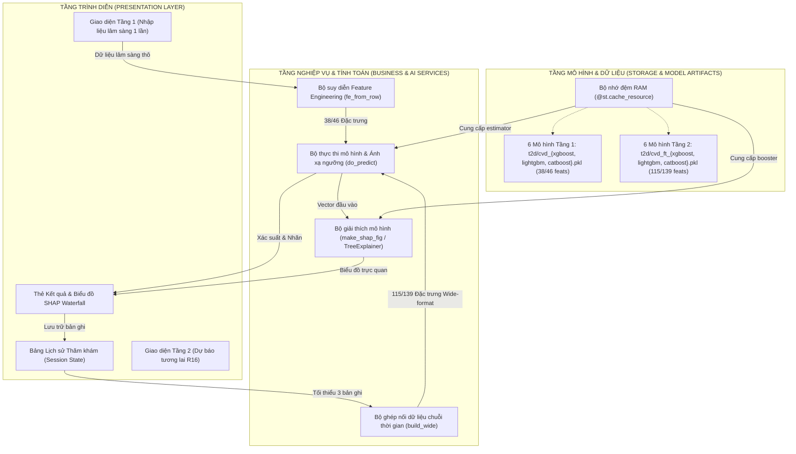

# CHƯƠNG III: TRIỂN KHAI HỆ THỐNG

---

## 1. Môi trường và công cụ phát triển

### 1.1. Môi trường phần cứng và hệ điều hành
Quá trình xây dựng, thử nghiệm và đóng gói hệ thống MedCare được thực hiện trên môi trường máy trạm chuyên dụng với các thông số cấu hình tiêu chuẩn:
* **Bộ vi xử lý (CPU):** AMD Ryzen / Intel Core i7 đa nhân thế hệ mới, hỗ trợ tăng tốc các phép tính song song (Parallel Computing) và tính toán giải thích SHAP Values.
* **Bộ nhớ trong (RAM):** 16 GB DDR4/DDR5, đáp ứng việc nạp đồng thời toàn bộ 12 mô hình Machine Learning và lưu trữ session state của phiên làm việc.
* **Ổ cứng lưu trữ:** NVMe M.2 SSD đảm bảo tốc độ đọc/ghi dữ liệu, nạp mô hình từ các tệp nhị phân nén dung lượng lớn với độ trễ tối thiểu.
* **Hệ điều hành:** Microsoft Windows 11 64-bit, hỗ trợ Windows PowerShell và môi trường ảo hóa phân lập.

### 1.2. Môi trường phần mềm và ngôn ngữ lập trình
* **Ngôn ngữ lập trình:** **Python 3.10+** – ngôn ngữ lập trình tiêu chuẩn trong lĩnh vực Khoa học Dữ liệu (Data Science) và Học máy (Machine Learning).
* **Quản lý môi trường ảo:** Sử dụng `venv` kết hợp trình quản lý gói `uv` / `pip` nhằm cô lập các gói thư viện, ngăn ngừa xung đột phiên bản phụ thuộc.
* **Môi trường phát triển tích hợp (IDE):** Antigravity IDE / Visual Studio Code, kết hợp môi trường Jupyter Notebook cho giai đoạn tiền xử lý và huấn luyện mô hình.

### 1.3. Các thư viện và công cụ chuyên dụng
Hệ thống sử dụng các thư viện phần mềm mã nguồn mở chuẩn công nghiệp:

| Nhóm công cụ | Tên thư viện | Phiên bản / Vai trò chính trong hệ thống |
| :--- | :--- | :--- |
| **Giao diện Web & Ứng dụng** | `streamlit` | Nền tảng xây dựng Web Application phản hồi nhanh, quản trị trạng thái người dùng (`st.session_state`) và hiển thị động. |
| **Xử lý & Cấu trúc dữ liệu** | `pandas`, `numpy` | Biến đổi ma trận dữ liệu, tính toán vector hóa các đặc trưng kỹ thuật (Feature Engineering) và xoay chiều dữ liệu (Pivot/Wide-format). |
| **Học máy (Machine Learning)** | `xgboost`, `lightgbm`, `catboost` | Bộ ba thuật toán Gradient Tree Boosting chủ đạo, thực thi các mô hình phân loại nhị phân đã được huấn luyện tối ưu. |
| **Quản lý & Đóng gói mô hình** | `joblib` | Serialization và Deserialization các đối tượng mô hình máy học sang định dạng `.pkl` với cơ chế nén hiệu quả. |
| **Trí tuệ nhân tạo có thể giải thích (XAI)** | `shap` | Khởi tạo đối tượng `TreeExplainer` nhằm tính toán đóng góp Shapley values của từng đặc trưng trên từng dự đoán cụ thể. |
| **Đồ họa & Trực quan hóa** | `matplotlib` | Kết xuất các biểu đồ SHAP Waterfall dưới dạng đồ họa vector/raster qua backend tĩnh `Agg` để nhúng vào web. |

---

## 2. Đặc tả yêu cầu hệ thống

Hệ thống được thiết kế theo hướng người dùng đóng vai trò trung tâm (User-Centered Design), cung cấp công cụ hỗ trợ đánh giá nguy cơ lâm sàng một cách minh bạch, trực quan và dễ tiếp cận.

### 2.1. Yêu cầu chức năng (Functional Requirements - FR)

* **FR1 - Quản lý bài toán bệnh lý:**
  * Hệ thống chia tách rõ ràng hai bệnh mãn tính qua hệ thống Tabs độc lập:
    1. *Đái tháo đường Type 2 (T2D - Type 2 Diabetes).*
    2. *Bệnh tim mạch (CVD - Cardiovascular Disease).*
  * Người dùng có thể chuyển đổi linh hoạt mà không làm mất dữ liệu đã nhập hay lịch sử của bài toán còn lại.

* **FR2 - Phân hệ Tầng 1 (Đánh giá nguy cơ tại một thời điểm - Cross-sectional):**
  * Tiếp nhận các chỉ số cơ bản về nhân khẩu học, thể trạng, thói quen sinh hoạt và bệnh lý nền tại 1 lần thăm khám.
  * **Cơ chế tự động hóa Feature Engineering:** Tự động tính toán các đặc trưng phức hợp (như $WtHR$, $BMI \times Waist$, điểm hoạt động thể chất, chỉ số rối loạn giấc ngủ, log thu nhập, huyết áp trung bình MAP...) từ các trường thông tin thô mà người dùng không cần tính toán thủ công.
  * Cho phép lựa chọn 1 trong 3 thuật toán huấn luyện: **XGBoost**, **LightGBM**, hoặc **CatBoost**.
  * Xuất kết quả phân loại nhị phân (Nguy cơ Cao / Nguy cơ Thấp), xác suất phần trăm kèm thanh tiến trình trực quan.

* **FR3 - Giải thích mô hình bằng XAI (Explainable AI):**
  * Tích hợp thuật toán SHAP Waterfall Plot cho từng ca dự đoán riêng lẻ.
  * Chỉ rõ các yếu tố kéo nguy cơ tăng lên (màu đỏ) và các yếu tố giúp giảm thiểu nguy cơ (màu xanh), tạo niềm tin và hỗ trợ định hướng điều chỉnh lối sống.

* **FR4 - Quản lý lịch sử thăm khám (Session History):**
  * Tự động lưu lại toàn bộ các lần dự đoán Tầng 1 (thời điểm, chỉ số nhập vào, thuật toán chọn, kết quả dự đoán).
  * Hiển thị bảng tóm tắt lịch sử trực quan; hỗ trợ nút chức năng làm mới/xóa lịch sử để bắt đầu phiên làm việc mới.

* **FR5 - Phân hệ Tầng 2 (Dự báo xu hướng tương lai dài hạn - Longitudinal):**
  * Khóa an toàn: Tầng 2 chỉ kích hoạt khi người dùng tích lũy **tối thiểu 3 lần thăm khám** ở Tầng 1.
  * Tự động tổng hợp và ánh xạ 3 bản ghi lịch sử gần nhất thành cấu trúc dữ liệu bảng dạng rộng (Wide format: các đợt khảo sát $R13, R14, R15$).
  * Dự báo nguy cơ mắc bệnh ở mốc thời gian tiếp theo trong tương lai ($R16$), kèm bảng kiểm toán dữ liệu đầu vào và biểu đồ SHAP Tầng 2.

### 2.2. Yêu cầu phi chức năng (Non-Functional Requirements - NFR)

* **NFR1 - Hiệu năng và Tốc độ đáp ứng (Performance & Latency):**
  * Thời gian phản hồi dự đoán của các mô hình cây quyết định: $< 0.1$ giây.
  * Thời gian tính toán và kết xuất biểu đồ SHAP Waterfall: $< 1.5$ giây.
  * Toàn bộ 12 mô hình được tải vào RAM ngay khi khởi động thông qua cơ chế lưu đệm `@st.cache_resource`, loại bỏ hoàn toàn chi phí đọc đĩa cho các lượt dự đoán tiếp theo.
* **NFR2 - Tính toàn vẹn và Nhất quán dữ liệu (Data Integrity):**
  * Quy trình Feature Engineering trong giao diện khớp 100% với logic đã được xử lý trong tập dữ liệu tiền xử lý của dự án, đảm bảo mô hình nhận đúng số lượng và thứ tự cột đặc trưng.
* **NFR3 - Tính khả dụng và Trải nghiệm người dùng (Usability & UX):**
  * Giao diện phong cách tối hiện đại (Modern Dark Theme), các nhóm thông tin được thu gọn/mở rộng logic (Collapsible Accordion), có ràng buộc giá trị nhập hợp lý (`min`, `max`, `step`, `default`).
* **NFR4 - Khả năng tương thích và triển khai (Deployability):**
  * Ứng dụng tích hợp bộ nạp tự động (Auto-bootstrap): có thể vận hành trực tiếp thông qua lệnh `streamlit run app.py` hoặc chạy bằng nút Run thông thường của IDE (`python app.py`) mà không bị lỗi ngữ cảnh bare-mode.

---

## 3. Thiết kế kiến trúc hệ thống

Hệ thống MedCare được tổ chức theo kiến trúc phân tầng dạng **Layered Architecture** nhằm phân tách rõ rệt giữa giao diện biểu diễn, tầng xử lý nghiệp vụ - đặc trưng và tầng mô hình lưu trữ.

### 3.1. Phân tầng kiến trúc
1. **Tầng Trình diễn (Presentation Layer):**
   * Được xây dựng dựa trên Streamlit và tùy biến qua CSS hiện đại (Inter Font, Dark Gradient, Glassmorphism).
   * Chịu trách nhiệm hiển thị form tương tác, validate dữ liệu người dùng, hiển thị kết quả chẩn đoán và trực quan hóa các biểu đồ phân tích giải thích.
2. **Tầng Nghiệp vụ (Business Logic & Processing Layer):**
   * **`fe_from_row`:** Module biến đổi dữ liệu thô thành các chỉ số sinh học dẫn xuất ($WtHR$, $RPP$, $MAP$, $Smoking\_Status$,...).
   * **`build_wide`:** Thuật toán biến đổi dữ liệu theo chiều dọc (Longitudinal data synthesizer), ghép 3 wave gần nhất thành vector đặc trưng phẳng 115 chiều (cho T2D) và 139 chiều (cho CVD).
   * **`do_predict`:** Xử lý ma trận đầu vào qua mô hình tương ứng, tính toán xác suất tiên nghiệm và so khớp với ngưỡng tối ưu ($Threshold = 0.5$).
   * **`make_shap_fig`:** Trích xuất ma trận Shapley values từ cây quyết định và kết xuất đồ thị thác nước (Waterfall plot) top 15 biến có ảnh hưởng nhất.
3. **Tầng Lưu trữ & Mô hình (Storage Layer):**
   * Hệ thống 12 tệp mô hình đã qua tối ưu hóa bằng Optuna và Early Stopping, sẵn sàng nạp tức thì:
     * **Tầng 1 (Hiện tại):** `t2d_xgboost.pkl`, `t2d_lightgbm.pkl`, `t2d_catboost.pkl`, `cvd_xgboost.pkl`, `cvd_lightgbm.pkl`, `cvd_catboost.pkl`.
     * **Tầng 2 (Tương lai):** `t2d_ft_xgboost.pkl`, `t2d_ft_lightgbm.pkl`, `t2d_ft_catboost.pkl`, `cvd_ft_xgboost.pkl`, `cvd_ft_lightgbm.pkl`, `cvd_ft_catboost.pkl`.

---

## 4. Giao diện ứng dụng

Giao diện MedCare được thiết kế theo phong cách giao diện y tế cao cấp (Clinical Modern Aesthetic) với bảng màu **Deep Midnight Slate**, độ tương phản cao, tối ưu hóa thị giác khi sử dụng liên tục.

### 4.1. Hệ thống thẻ màu và Typography (Design Tokens)
* **Màu nền ứng dụng:** Gradient đa điểm chuyển sắc từ Dark Violet sang Deep Navy (`#0f0f23` $\rightarrow$ `#1a1a3e` $\rightarrow$ `#0d1b2a`).
* **Hiệu ứng giao diện:** Kính mờ cường lực (Glassmorphism với `backdrop-filter: blur(8px)` và viền sáng nhẹ `rgba(99,102,241,0.22)`).
* **Màu chỉ báo lâm sàng:**
  * **Cảnh báo nguy cơ cao:** Đỏ Crimson sang Hồng cánh sen (`#ef4444` / `#f43f5e`).
  * **Cảnh báo an toàn (Nguy cơ thấp):** Xanh ngọc Emerald (`#10b981`).
  * **Điểm nhấn tương tác (Buttons/Accents):** Gradient Indigo - Tím Electric (`#6366f1` $\rightarrow$ `#8b5cf6`).

### 4.2. Chi tiết các màn hình chức năng chính

#### A. Màn hình giám sát và thanh điều hướng chính
* Phần đầu trang (Header) hiển thị biểu tượng, tiêu đề ứng dụng và phụ đề kỹ thuật làm nổi bật sự kết hợp giữa 3 thuật toán XGBoost/LightGBM/CatBoost và giải thích XAI.
* Một vùng mở rộng **"Trạng thái mô hình"** cho phép kiểm toán nhanh tính khả dụng của toàn bộ 12 mô hình nạp trong hệ thống.
* Hai thẻ Tabs lớn để chuyển đổi giữa hai bệnh cảnh: **🩸 Đái Tháo Đường (T2D)** và **❤️ Bệnh Tim Mạch (CVD)**.

#### B. Phân khu nhập liệu lâm sàng Tầng 1
Các chỉ số được phân loại khoa học thành các nhóm mở rộng (Expander) giúp giảm tải nhận thức cho người dùng:
1. *Nhân khẩu học:* Giới tính, Tuổi.
2. *Thể trạng:* Chiều cao, Cân nặng, Vòng eo, BMI.
3. *Huyết áp & Nhịp tim:* Huyết áp tâm thu, Huyết áp tâm trương, Nhịp tim (riêng cho CVD).
4. *Lối sống & Thói quen:* Hút thuốc lá, Uống rượu bia, Mức độ vận động (Nặng / Vừa / Nhẹ).
5. *Chất lượng giấc ngủ:* Tình trạng mất ngủ, mệt mỏi buổi sáng, ngủ ngáy, ngưng thở khi ngủ.
6. *Bệnh lý nền & Thuốc điều trị:* Huyết áp cao, Viêm khớp, Thuốc điều trị mỡ máu, Tình trạng mãn kinh, Khó thở khi gắng sức.

#### C. Thẻ kết quả phân tầng nguy cơ và Biểu đồ giải thích SHAP
* **Thẻ kết quả (Result Card):**
  * Huy hiệu trạng thái: **NGUY CƠ CAO** hoặc **NGUY CƠ THẤP**.
  * Thanh đo xác suất (Progress bar) thể hiện trực quan mức độ rủi ro từ 0% đến 100%.
  * Hệ thống 3 chỉ số Metric dạng khối: Nhãn kết luận, Xác suất chính xác và Ngưỡng phân loại thiết lập ($0.50$).
* **Giải thích SHAP Waterfall (Local Explanation):**
  * Hiển thị giá trị cơ sở khởi điểm $E[f(X)]$ của toàn bộ quần thể.
  * Từng mũi tên đỏ/xanh chỉ rõ chính xác đặc trưng nào (ví dụ: *Vòng eo tăng 95cm* hay *Huyết áp tâm thu 145mmHg*) đã đẩy xác suất rủi ro vượt ngưỡng bệnh lý.

#### D. Khu vực lưu trữ lịch sử thăm khám
* Bảng tương tác hiển thị danh sách các lần khám đã thực hiện trong phiên làm việc.
* Cung cấp nút bấm **"Xóa lịch sử"** giúp đặt lại trạng thái về ban đầu khi cần thăm khám cho bệnh nhân khác.

#### E. Phân khu dự báo Tầng 2 (Dài hạn)
* Khi số lượng bản ghi lịch sử $< 3$: Hiển thị cảnh báo trạng thái đi kèm thanh tiến trình động thông báo số lần khám cần tích lũy thêm (ví dụ: *"Cần thêm 1 lần khám nữa để kích hoạt Tầng 2 (2/3)"*).
* Khi đã đủ $\ge 3$ bản ghi: Hệ thống mở khóa giao diện Tầng 2. Người dùng chọn thuật toán tương ứng và bấm **"Dự đoán Tầng 2"**.
* Giao diện xuất kết quả dự báo nguy cơ trong tương lai ($R16$), biểu đồ SHAP cho các chuỗi biến động qua các wave và cho phép người dùng mở rộng kiểm tra bảng dữ liệu đã tổng hợp (Wide DataFrame view).

---

## 5. Kết chương

Chương III đã trình bày chi tiết và toàn diện quá trình thiết kế, hiện thực hóa và đóng gói hệ thống đánh giá nguy cơ bệnh mãn tính **MedCare**:
1. **Thiết lập nền tảng công nghệ vững chắc:** Sử dụng Python, Streamlit, Scikit-learn, XGBoost, LightGBM, CatBoost và SHAP, đảm bảo sự phân lập, tốc độ và tính tương thích trên mọi môi trường máy trạm.
2. **Hiện thực hóa mô hình phân tầng độc đáo:** Chuyển đổi thành công bài toán học máy phức tạp từ nghiên cứu thành ứng dụng tương tác thực tế với hai tầng xử lý: Tầng 1 (đánh giá cắt ngang tại một thời điểm) và Tầng 2 (dự báo xu hướng chuỗi thời gian dài hạn).
3. **Đảm bảo tính giải thích minh bạch (Explainable AI):** Không chỉ đưa ra kết quả phân loại dạng "hộp đen", hệ thống đã tích hợp SHAP Waterfall Plot giúp người dùng và bác sĩ hiểu rõ căn nguyên dẫn đến rủi ro sức khỏe.
4. **Trải nghiệm người dùng chuyên nghiệp:** Giao diện tối ưu, hiện đại, tự động hóa tính toán các chỉ số phức tạp, sẵn sàng phục vụ công tác demo thực nghiệm và định hướng mở rộng ứng dụng trong y tế số.
